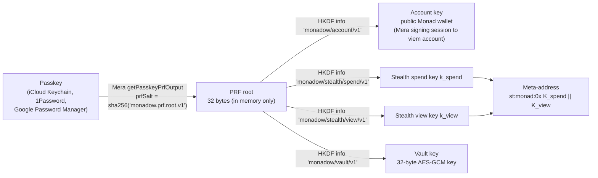
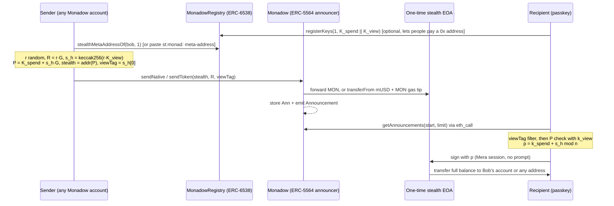

# Monadow

**Private stealth payments on Monad. One passkey is your entire account: wallet, stealth keys and vault key, with no seed phrase and no extension.**

- Live app: https://erhantrk.github.io/monadow/
- SDK on npm: [`monadow-sdk`](https://www.npmjs.com/package/monadow-sdk)
- Demo video: https://youtu.be/jkc8Qs6ovJs
- Network: Monad testnet (chainId 10143)
- Built for the Monad Metropolis hackathon (solo: Erhan Türker)

---

## Problem

Every payment on a public chain links the payer, the payee and the amount forever. Share your address once to get paid and anyone can read your balance, your income and the list of people who pay you. Stealth addresses (ERC-5564) fix the receiver side: each payment lands at a fresh one-time address that only the recipient can find and spend. In practice, though, stealth wallets add more key management on top of the usual seed phrase and extension: a spending key, a viewing key, a scanner, and somewhere to keep them all safe.

Monadow removes that overhead. A single passkey (Face ID, Touch ID, Windows Hello, a phone or a password manager) deterministically produces every key the user needs, and nothing essential is stored on the device.

## Users

- **Freelancers and contributors** who invoice in crypto and don't want each client to see their whole wallet.
- **Creators and causes** that accept tips or donations from a public link or QR code.
- **Small merchants and teams** paying or receiving on Monad who want receiver privacy without asking anyone to install a wallet.

All of them can share one public **meta-address** (or a registered `0x` address) and still receive every payment at an address nobody else can link to them.

## How it works

### One passkey, many keys

One WebAuthn ceremony through [Mera](https://mera.category.xyz) evaluates the passkey's PRF extension with a fixed salt. The 32-byte output is the root secret. HKDF-SHA256 splits it into independent, domain-separated namespaces:



The same passkey on any device produces the same keys, so clearing site data or switching browsers loses nothing: the keys come back from the passkey and the payments come back from the chain.

### Send, announce, scan, withdraw



Full formulas, contract layout and the threat model are in [docs/ARCHITECTURE.md](docs/ARCHITECTURE.md).

## Why Monad

- **A fresh address per payment is cheap.** Every Monadow payment creates a new one-time EOA and a stored announcement. Low fees make per-payment addresses practical instead of a luxury.
- **400 ms blocks make privacy feel instant.** Sending, scanning and withdrawing happen in a few seconds, which matters when the alternative is "just paste your main address".
- **EVM compatible, so standards apply.** Monadow uses the ERC-5564 `Announcement` event and an ERC-6538-style registry unchanged, so wallets and indexers that already speak those standards can interoperate.
- **Built around Monad's execution model.** Monad charges gas on the gas limit, so the SDK sets explicit, tight limits (estimate × 1.3 with per-call floors). Native withdrawals follow Monad's reserve-balance rules: the SDK waits until the funding tx is 3 blocks old, then sweeps the exact balance (balance − gasLimit·gasPrice) so the stealth address ends at zero.
- **Scanning without `eth_getLogs`.** Announcements are also kept in contract storage and read in pages via `eth_call`, so the inbox works on any public Monad RPC without log-range limits.

## Deployed contracts (Monad testnet, chainId 10143)

All three contracts are verified on Sourcify (exact match). Deploy block: `70789800`.

| Contract | Role | Address |
|---|---|---|
| `Monadow` | ERC-5564 announcer + sender, on-chain announcement storage | [`0x4386667A6A31E2324AdBfA4CD80E1f1c6A626783`](https://testnet.monadvision.com/address/0x4386667A6A31E2324AdBfA4CD80E1f1c6A626783) |
| `MonadowRegistry` | ERC-6538 subset: stealth meta-address registry | [`0x567FA1e916BE75A824CA7924377DfdE0c07150e5`](https://testnet.monadvision.com/address/0x567FA1e916BE75A824CA7924377DfdE0c07150e5) |
| `MockUSD` | "Monadow USD" (mUSD, 6 decimals) test token with public `mint` | [`0xCC183F736cAfED29B054C094A238D20eA8dE3c19`](https://testnet.monadvision.com/address/0xCC183F736cAfED29B054C094A238D20eA8dE3c19) |

Example transactions (from `contracts/deployments/10143.json`):

| What | Tx hash |
|---|---|
| Deploy `Monadow` | [`0xb7cdda8a…4a00f61a`](https://testnet.monadvision.com/tx/0xb7cdda8a7dc812f4fa6ed67751d748dac820872836153982661229804a00f61a) |
| Deploy `MonadowRegistry` | [`0x50c62163…4857ca`](https://testnet.monadvision.com/tx/0x50c62163b2190ec7c3b438da4b4d3514103321341e2cce54c8d1bbdafd4857ca) |
| Deploy `MockUSD` | [`0x9ca43a3e…5f8430a`](https://testnet.monadvision.com/tx/0x9ca43a3ed14a10eb33f816cd691b5f73cb33c5dbb0ab1a84b230601ed5f8430a) |
| Mint 100 mUSD | [`0x7ca89560…71ee1a`](https://testnet.monadvision.com/tx/0x7ca895602940d9c633b254ed3c64f820262438ba97fb37f2373257834871ee1a) |
| `sendNative` (MON to a stealth address) | [`0xaa60b217…1e0257c`](https://testnet.monadvision.com/tx/0xaa60b2170495038583ad26592148860e3916568905792af17c48a25961e0257c) |
| `approve` mUSD | [`0x3d181c78…849d1`](https://testnet.monadvision.com/tx/0x3d181c780141009bdcbad0ee4d7a2020e7f22358958d87eeeb8fee00769849d1) |
| `sendToken` (10 mUSD + MON gas tip to a stealth address) | [`0x652740c8…56c3224a6a57a`](https://testnet.monadvision.com/tx/0x652740c890685e57fb8d7dd9daa2de29f8c3b616b2ff48cd5e056c3224a6a57a) |

### End-to-end proof

**Real passkey, live site.** Touch ID in Safari on https://erhantrk.github.io/monadow/ created the passkey. Mera then ran the signing session, and the user's account `0x70d14eb965e3cf0cfd1889873fe44fc2bbafb0c2` did the rest:

| What | Tx hash |
|---|---|
| Publish meta-address (signed via Mera session, no extra prompt) | [`0xc88e3b22…6f393f33`](https://testnet.monadvision.com/tx/0xc88e3b2238022d4d709f21aea3e8462f3da1c4a5307b391e9bcc1bff6f393f33) |
| Private payment of 0.05 MON to that 0x address (lands at one-time `0x6cE6A1f6…3f5Ff6183`) | [`0x1e34caf0…688c1f4e`](https://testnet.monadvision.com/tx/0x1e34caf0c5f9876ca05529d1d47ffd422b50250415b78d9e460ef938688c1f4e) |
| Private payment of 250 mUSD plus gas tip (lands at one-time `0x31812790…bDA84b98e0`) | [`0x98c98674…09b20f98`](https://testnet.monadvision.com/tx/0x98c98674768525a2aebbd115b6633475ece654506170dc39400dd04009b20f98) |

The user then scanned the Inbox in the live app and withdrew both payments to their account, with no prompts.

**SDK e2e** (`packages/sdk/scripts/e2e.ts`): register, send MON and mUSD, scan, then withdraw.

| What | Tx hash |
|---|---|
| `registerKeys` | [`0xd6331552…a1f9af15`](https://testnet.monadvision.com/tx/0xd633155278ed52a8e5561c1f3741473c3b216b1fe34fad85f6c92c91a1f9af15) |
| `sendNative` 0.01 MON | [`0x12bd3bcd…6dbbf83f`](https://testnet.monadvision.com/tx/0x12bd3bcd269c792c9eb0575dab2adc7a10e7a41ed76cacf83bddb5df6dbbf83f) |
| `sendToken` 5 mUSD + tip | [`0x2f2e4e5c…85bd15fe`](https://testnet.monadvision.com/tx/0x2f2e4e5c5b8c7c08bbe92b805820c899c096c0bc5f3a21b2b9e6665185bd15fe) |
| Withdraw MON from the stealth address (Mera signing session) | [`0x6b5bfc04…87547b23`](https://testnet.monadvision.com/tx/0x6b5bfc04b6db849cb36687c25fc4cf46554491a60d0e9255d71bac2f87547b23) |
| Withdraw mUSD from the stealth address | [`0x3f1d570e…b206c02d`](https://testnet.monadvision.com/tx/0x3f1d570e28b186860d564022f6497238bea2300d591379efb4d33bd3b206c02d) |
| Sweep the leftover gas tip | [`0xe797d40b…585c74d2`](https://testnet.monadvision.com/tx/0xe797d40b08f5425e2c9c5a7e352440017e94bad538bb4d4878016cc1585c74d2) |


## Mera integration: Mera is the entire account layer

Monadow has no seed phrase, no extension and no "connect wallet" button. [Mera](https://mera.category.xyz) by Category Labs provides all of it:

- **One-prompt onboarding.** "Create new passkey" calls `createPasskeyWithPrfOutput` with the Monadow PRF salt, so the passkey is created and the PRF root is returned in the same ceremony. Returning users press "Continue with passkey" (`getPasskeyPrfOutput`): one prompt, and every key is derived in milliseconds. (Some authenticators don't evaluate PRF at creation time and need a second prompt; Mera handles that case.)
- **Prompt-free signing session.** The derived account key goes straight into `createSecp256k1SigningSession`, and `toViemAccount` turns the session into a viem account. Every account transaction (mint, register, send) signs without another prompt while the session is active. Withdrawals open a short-lived Mera session for each one-time stealth key and end it after signing. The header shows "Signing session active · prompt-free", and **Lock** ends every session and drops the keys.
- **Stateless test.** Nothing needed to recover the account is stored. `localStorage` holds only a public credential-ID hint (so the browser can go straight to the right passkey) and, if the user writes any, AES-GCM ciphertext of private notes. Clear site data, open a fresh profile or use another device that has the same synced passkey: one prompt gives the same account address and meta-address, the "published" status is read back from the registry, and the inbox rebuilds from an on-chain scan of announcements.

### One passkey, many keys

The PRF root is never used directly. HKDF-SHA256 with distinct `info` strings gives four independent keys: `monadow/account/v1` (public wallet), `monadow/stealth/spend/v1` and `monadow/stealth/view/v1` (an unlinkable privacy identity that never signs from the public wallet), and `monadow/vault/v1` (an AES-256-GCM key that encrypts private payment notes; only ciphertext is written to `localStorage`, treated as untrusted storage, under slot IDs that are an HMAC of the stealth address so the storage doesn't reveal which addresses are yours). Knowing one key reveals nothing about the others, and the account address can't be linked to the meta-address from on-chain data unless the user publishes that link in the registry. Because the keys are deterministic, the same passkey decrypts the same note ciphertext on any device; in the current build that ciphertext stays in the browser where it was written, so notes don't follow the user to a new device or survive clearing site data.

## Repo structure

```
contracts/            Foundry project
  src/                Monadow.sol, MonadowRegistry.sol, MockUSD.sol
  test/               Monadow.t.sol (unit + fuzz tests)
  script/Deploy.s.sol deploys all three and writes deployments/<chainId>.json
  deployments/        10143.json: addresses, deploy block, deploy and smoke tx hashes
  abi/                exported ABIs (export-abi.sh)
  lib/forge-std/      vendored forge-std
packages/sdk/         monadow-sdk (TypeScript, ESM + CJS via tsup)
  src/crypto.ts       key derivation, meta-address, stealth math
  src/client.ts       MonadowClient: register, resolve, send, scan, withdraw
  src/mera.ts         monadow-sdk/mera: passkey unlock + Mera signing sessions
  test/               vitest (known-answer vectors, round-trips)
  scripts/e2e.ts      end-to-end run against Monad testnet
apps/web/             Vite + React 18 + TypeScript + Tailwind 4, deployed to GitHub Pages
docs/ARCHITECTURE.md  crypto spec, contract design, threat model
submission/           hackathon submission material
SPEC.md               build spec
```

## Quick start (judges)

1. Open **https://erhantrk.github.io/monadow/** in a browser with a PRF-capable passkey provider: iCloud Keychain (Safari or Chrome on macOS, iOS 18+), 1Password, or Google Password Manager in Chrome on desktop or Android.
2. Click **Create new passkey**. Approve the single prompt. You land on Home with your account address and meta-address.
3. Copy your account address and get test MON from the faucet: https://faucet.monad.xyz
4. Click **Mint 100 mUSD**.
5. Click **Publish meta-address on-chain**, so others can pay your plain `0x` address privately.
6. In a second browser profile or device, create a second passkey, fund it, open **Send**, enter the first account's `st:monad:` meta-address or its published `0x` address, pick MON or mUSD and click **Send privately**.
7. Back in the first profile, open **Inbox** (it scans on open; **Scan again** rescans). Optionally add a private note to the payment (encrypted with the vault key). Withdraw to **My account** or a **Custom address**: no passkey prompt.
8. Stateless test: click **Lock**, clear site data (or open a new profile with the same synced passkey), press **Continue with passkey**, and check that the same account address, meta-address, published status and payments come back.

If the browser reports that PRF is unavailable, the app says so and suggests a supported provider.

## Local development

Requirements: Node 18+ (Node 20+ recommended), npm, and [Foundry](https://book.getfoundry.sh/) for the contracts.

```bash
git clone https://github.com/erhantrk/monadow.git
cd monadow
npm install

# SDK
npm run build:sdk                 # builds packages/sdk/dist
npm test -w monadow-sdk           # vitest

# Web app (http://localhost:5173/monadow/)
npm run dev
# Over the LAN with a self-signed cert (for testing passkeys on a phone):
HTTPS=true npm run dev
npm run build:web                 # production build to apps/web/dist

# Contracts
cd contracts
forge build
forge test -vv
```

WebAuthn requires a secure context: `localhost` works; for any other host, serve over HTTPS. Passkeys are bound to the hostname (the relying-party ID is `window.location.hostname`), so a passkey created on `localhost` is not the same as one created on `erhantrk.github.io`, and they derive different keys.

### Deploying the contracts

Create a `.env` at the repo root (it is gitignored):

```
DEPLOYER_PRIVATE_KEY=0x...
DEPLOYER_ADDRESS=0x...
MONAD_RPC_URL=https://testnet-rpc.monad.xyz
```

Then:

```bash
cd contracts
set -a; source ../.env; set +a
forge script script/Deploy.s.sol --rpc-url $MONAD_RPC_URL --broadcast --slow
./export-abi.sh                   # refresh contracts/abi/*.json
```

The script writes `contracts/deployments/<chainId>.json`. If you deploy your own copies, update `packages/sdk/src/deployments.ts` (or pass `addresses` to `MonadowClient`).

### SDK end-to-end test on testnet

`packages/sdk/scripts/e2e.ts` uses `DEPLOYER_PRIVATE_KEY` from `.env` as the sender: it derives a recipient from a random PRF value, funds and registers it, sends MON and mUSD to its `0x` address, scans, and withdraws both (one through a Mera signing session).

```bash
npm run e2e -w monadow-sdk
```

## SDK usage

```ts
import { createPublicClient, createWalletClient, http, parseEther } from 'viem';
import { MONAD_TESTNET, MonadowClient, deriveMonadowKeys, DEPLOYMENTS } from 'monadow-sdk';
import { unlockWithPasskey, meraAccount, meraAccountFactory } from 'monadow-sdk/mera';

// 1. One passkey prompt → every key (create: true for first use)
const { keys } = await unlockWithPasskey({ rpId: location.hostname, rpName: 'My app' });
// keys.accountAddress, keys.metaAddress ('st:monad:0x…'), keys.viewingPrivateKey, …
// For tests or servers without WebAuthn: deriveMonadowKeys(prfOutput32Bytes)

// 2. Prompt-free account signer from a Mera session
const { account } = meraAccount(keys.accountPrivateKey);
const publicClient = createPublicClient({ chain: MONAD_TESTNET, transport: http() });
const walletClient = createWalletClient({ chain: MONAD_TESTNET, transport: http(), account });
const monadow = new MonadowClient({ publicClient, walletClient });

// 3. Publish your meta-address, pay someone privately
await monadow.registerMetaAddress(keys.metaAddress);
await monadow.sendNative('st:monad:0x…', parseEther('0.1'));          // or a registered 0x address
await monadow.sendToken('0xRecipient…', DEPLOYMENTS[10143].mockUsd, 10_000_000n); // 10 mUSD + 0.02 MON gas tip

// 4. Find and sweep what was sent to you
const payments = await monadow.scan(keys, { start: 0n });
for (const p of payments) {
  await monadow.withdraw(p, keys.accountAddress, { accountFactory: meraAccountFactory });
}
```

## Security notes and limitations

Monadow is a hackathon prototype. Read this before trusting it with anything.

- **Testnet only and unaudited.** Contracts and SDK have unit tests but no audit. Don't use them with real funds.
- **Receiver privacy only.** The sender is `msg.sender` of the send transaction and is recorded as `caller` in the announcement. Monadow hides *who received* a payment, not who sent it.
- **Amounts and assets are public.** The amount and token are in the announcement and the transfer.
- **Withdrawing can relink you.** Sweeping a stealth address to your public account address links that payment to you on-chain. For stronger privacy, withdraw to a fresh address, or leave funds in place and spend from the stealth address.
- **Gas-tip linkability.** A stealth address needs MON to pay gas for a token withdrawal, so `sendToken` forwards a small MON tip (default 0.02 MON) from the sender. That is private, but if leftover tips from several stealth addresses are swept to the same destination, those payments become linkable to each other. Native MON withdrawals sweep the exact balance and leave nothing behind.
- **Timing and amount correlation.** Sending a round amount and withdrawing it seconds later lets an observer link the two by timing.
- **Registry links identities if you choose.** Registering a meta-address under your account address publicly ties your account to your meta-address (not to individual payments). Sharing the `st:monad:` string off-chain avoids this.
- **Private notes are local.** Note ciphertext lives in the browser's `localStorage`. It is unreadable without the passkey, but it is not synced or backed up, so clearing site data deletes notes (payments and keys are unaffected).
- **Keys live in browser memory while unlocked.** Derived keys are held in JavaScript memory during the session. Lock ends the Mera sessions and zeroes the vault key, but JavaScript can't guarantee every copy (for example hex strings) is wiped. An XSS or a malicious extension on the page could read them.
- **The passkey is the account.** Losing every copy of the passkey loses the keys, and anyone who controls the passkey controls the funds. Use a synced passkey provider. Passkeys are scoped to the hostname, so the same passkey on a different domain derives different keys.
- **Scanning is linear.** The client reads every announcement since `start` and checks the view tag. Fine for a testnet, but it needs an indexer or a checkpoint at scale.

See [docs/ARCHITECTURE.md](docs/ARCHITECTURE.md#threat-model) for the full threat model.

## Lineage and pre-existing components

Monadow is a port and redesign of **[Shade](https://github.com/stellarshade-labs/Shade)**, a private payments protocol and dapp on Stellar by the same author, built **before** this hackathon.

**Reused from Shade:** the protocol design (passkey-derived spend/view keys, meta-addresses, announce-then-scan) and the web UI layout and component patterns (rebranded with a new palette and logo).

**Dropped:** Shade's Stellar-specific shielded pool, relayer and indexer. On an EVM chain, payments can go straight to a one-time stealth EOA, so none of those are needed. No Stellar or Freighter code is included.

**Animation components:** the motion system in `apps/web/src/motion/` (ledger drift, wordmark rise, lens grain, scroll reveals, view-key scan sweep, severance burst, count-ups) was adapted from [stellarshade-labs/Web](https://github.com/stellarshade-labs/Web), the pre-existing Shade website by the same author, and re-skinned for Monadow.

**New for the hackathon:** all Monad contracts (`Monadow`, `MonadowRegistry`, `MockUSD`), the secp256k1 / ERC-5564 SDK (`monadow-sdk`), the Mera integration, and the Monadow web app.

## Attribution

- [ERC-5564: Stealth Addresses](https://eips.ethereum.org/EIPS/eip-5564): scheme 1 (secp256k1 with view tags), `Announcement` event and metadata layout.
- [ERC-6538: Stealth Meta-Address Registry](https://eips.ethereum.org/EIPS/eip-6538): `registerKeys` / `stealthMetaAddressOf` / `StealthMetaAddressSet` subset.
- [viem](https://viem.sh) (MIT): clients, ABI encoding, transaction signing.
- [@noble/curves and @noble/hashes](https://paulmillr.com/noble/) by Paul Miller (MIT): secp256k1, keccak-256, SHA-256, HKDF.
- [Mera](https://mera.category.xyz) (`@category-labs/mera`) by Category Labs (MIT OR Apache-2.0): passkeys, PRF output, secp256k1 signing sessions, viem adapter.
- [forge-std](https://github.com/foundry-rs/forge-std) (MIT OR Apache-2.0): Foundry test and script helpers, vendored in `contracts/lib/forge-std`.
- Web app libraries: React, React Router, zustand, Tailwind CSS, Vite, lucide-react (icons), qrcode.react.

## AI disclosure

Monadow was built with help from **Claude Code**, Anthropic's AI coding assistant, which was used to write and review code, tests and documentation under the author's direction. The design, the decisions and the final responsibility for the code are the author's.

## License

[MIT](LICENSE) © 2026 Erhan Türker
